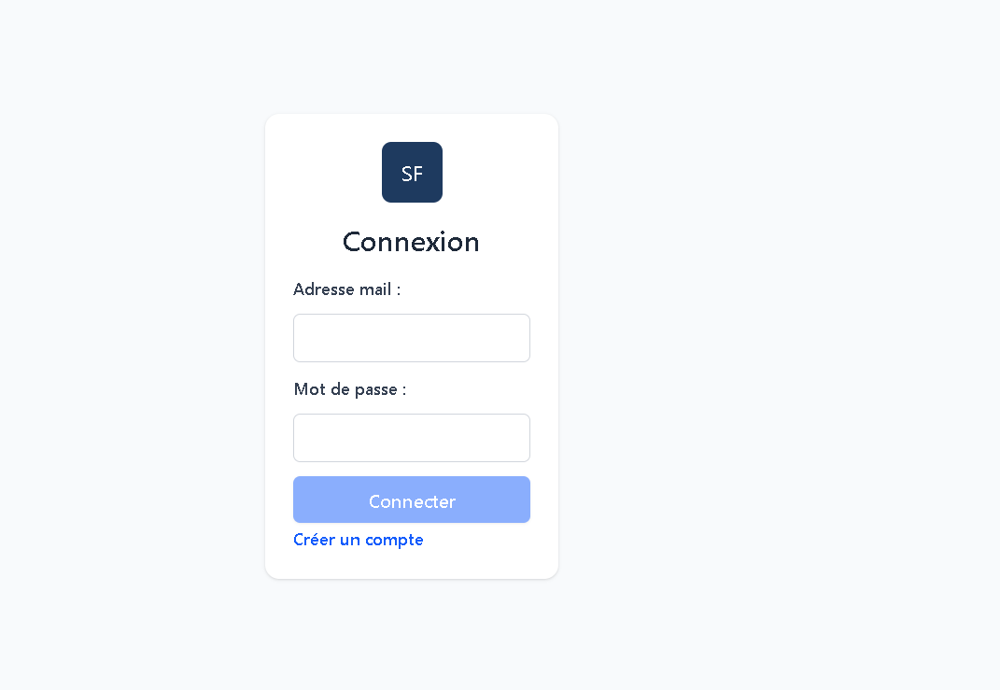
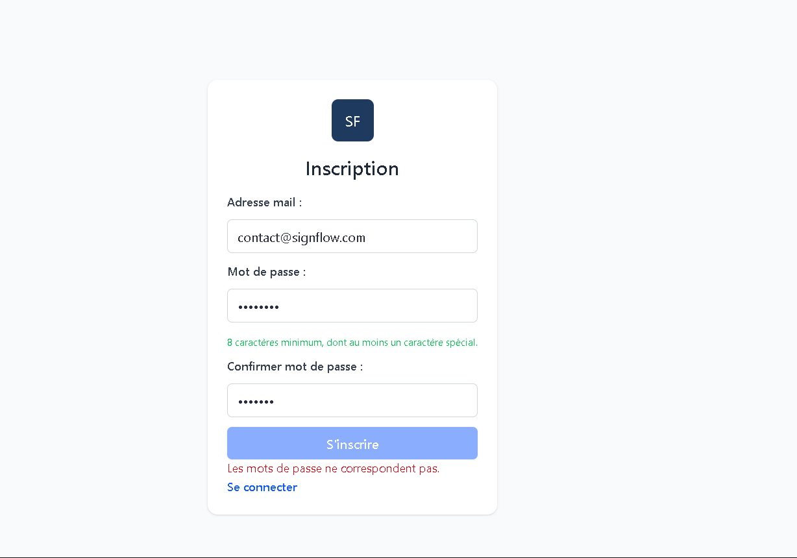

# Signflow

Projet d'apprentissage Angular : signals, computed, templates et routage, en route vers une appli de signature électronique.

## Prérequis

- Node.js 22 (avec npm)

## Installation

Dans un terminal :

```bash
git clone https://github.com/David-RC-code/signflow
cd signflow
npm install
```

Une fois les packages installés, lancer l'application :

```bash
npm start
```

Ouvrir dans le navigateur : [localhost:4200](http://localhost:4200)

## Statut

L'application est en cours de développement

### Elle affiche :

- Page de connexion avec validation des entrées utilisateur côté client.
- Page d'inscription avec validation des entrées utilisateur côté client.

## Contexte

Après quatre ans d'absence sur le marché du développement web, j'ai décidé de me remettre à niveau sur mes outils de prédilection : Angular et Node.js.

Pour cela, j'ai choisi de travailler avec une IA selon un principe de collaboration favorisant l'apprentissage par la pratique :

- Le code n'est pas fourni avant une première tentative personnelle.
- Une solution complète est proposée uniquement sur demande ou avec mon accord.
- L'IA me guide à l'aide d'indices et de défis progressifs.
- Des revues de code permettent d'identifier les axes d'amélioration.

# Screenshots

<!-- ## Page d'accueil

 -->

## Page d'authentification



## Page d'inscription

