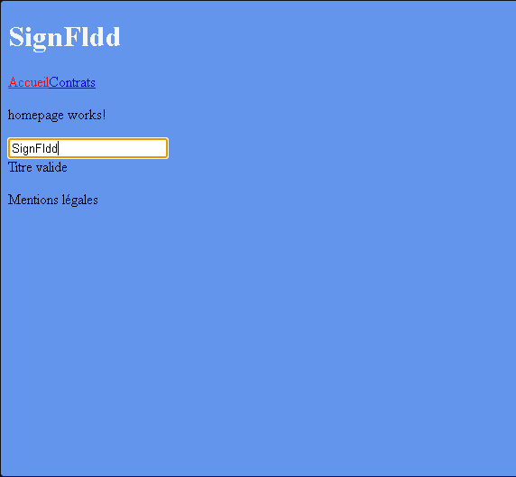
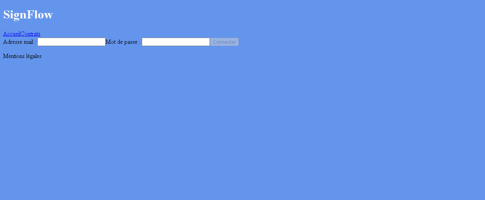

# Signflow

Projet d'apprentissage Angular : signals, computed, templates et routage, en route vers une appli de signature électronique.

## Prérequis

- Node.js 22 (avec npm)

## Installation

Dans un terminal :

```bash
git clone https://github.com/David-RC-code/signflow
cd signflow
npm install
```

Une fois les packages installés, lancer l'application :

```bash
npm start
```

Ouvrir dans le navigateur : [localhost:4200](http://localhost:4200)

## Statut

L'application est en cours de développement

### Elle affiche :

- Un champ de saisie permettant de modifier le titre dynamiquement.
- Une page d'authentification avec validation des entrées utilisateur côté client.

## Contexte

Après une absence de 4 ans sur le marché du web, j'ai décidé de me remettre à niveau dans mes outils de prédilection : Angular et Node.js. Pour cela, j'ai choisi de prendre un mentor : Claude, avec qui nous avons établi une sorte de contrat de collaboration. Il ne doit pas me donner le code à taper avant ma tentative ; il me fournit une solution complète seulement à ma demande ou avec mon accord ; il doit me challenger et m'orienter. Il fait des revues de code et me donne des axes d'amélioration.

# Screenshots

## Page d'accueil



## Page d'authentification


